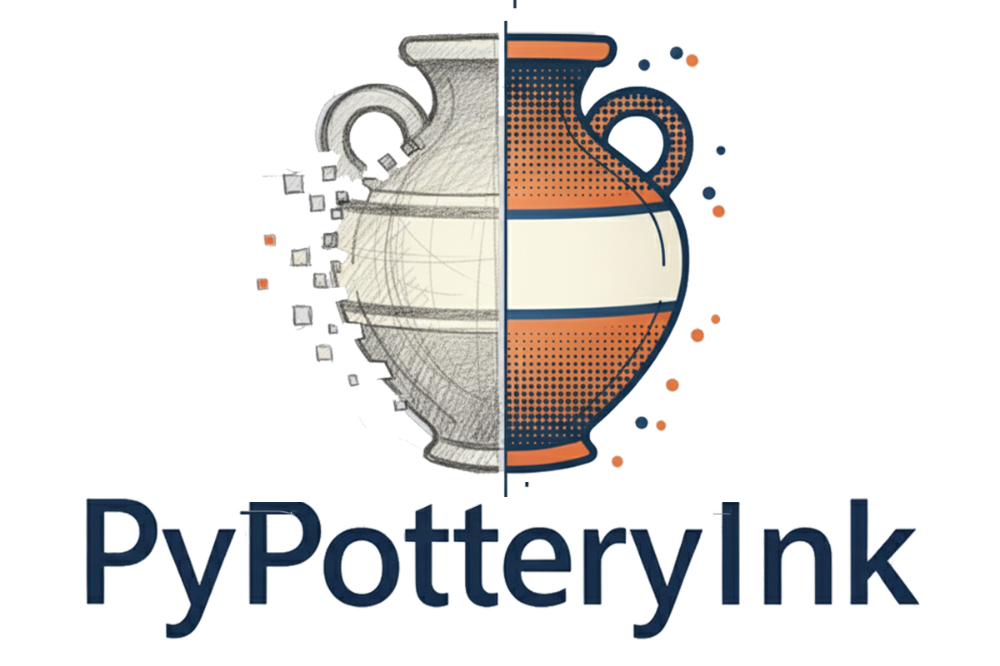

<div style="text-align: center;">
  
</div>

PyPotteryInk takes a scan or a photograph of a pencil pottery drawing and redraws it as clean ink line art, ready for publication. It does this with a generative model that works on the image in small squares (**patches**), so plates of any size can be processed. This guide follows the tabs of the app in the order you will normally use them. The **Need help?** button in the header of the app (Pixel) opens this page.

::: {.callout-note}
## The workflow at a glance
**Projects** (create one and add your drawings) → **Hardware Check** (once) → **Preprocessing** (optional) → **Model Diagnostics** (a few test drawings) → **Batch Processing** (the whole collection) → or **Cloud Inking** (optional, no GPU needed)
:::

<iframe src="../animations/coming_soon.html" name="Workflow overview" title="Animation coming soon: Workflow overview" style="width: 100%; height: 260px; border: none; overflow: hidden;" scrolling="no"></iframe>

## Key terms

| Term | Meaning |
|---|---|
| **Project** | The place where your drawings, their results and the history of every run are kept together. Everything in the app happens inside a project. |
| **Library** | The drawings of a project. They are added once and every tab picks from them. |
| **Model** | The trained "style" the app applies: one is best for Bronze Age drawings, another for painted pottery, and so on. See the [Model Zoo](model_zoo.qmd). |
| **Patch size** | The side, in pixels, of the squares the image is cut into (512 by default). Larger patches give the model more context but are slower. |
| **Overlap** | How many pixels neighbouring patches share (64 by default), so that no seams are visible between them. |
| **Contrast** | A factor applied to each patch before the model sees it: above 1 makes the pencil stronger, below 1 fainter. |
| **Scale factor** | Temporarily enlarges (above 1) or shrinks (below 1) the image before processing. The result is always saved at the original size. |
| **Statistics file** (`.npy`) | A small file that describes the brightness and contrast of a set of drawings. Preprocessing uses it to make your images resemble them. |

# Projects

A project is the first thing you need. Until one is open, the Preprocessing, Model Diagnostics, Batch Processing and Cloud Inking tabs show a prompt to open or create a project, and only **Projects** and **Hardware Check** can be used.

<iframe src="../animations/coming_soon.html" name="Projects" title="Animation coming soon: Projects" style="width: 100%; height: 260px; border: none; overflow: hidden;" scrolling="no"></iframe>

## Create a project and add the drawings

1. In the **Projects** tab, type a name (and, if you like, a short description) and click **Create and open**. Projects you made earlier are listed below the form: click one to open it.
2. Click **Add drawings** and choose image files or a whole folder (PNG, JPG, JPEG or TIFF), or drop them on the page. The drawings are **copied into the project**, so the project never mixes images from elsewhere and the originals are never touched.
3. The library shows a thumbnail of every drawing. Small chips tell you which ones are preprocessed and with how many different settings each has been inked.

The same image added twice is recognised by its content and copied only once. A different image with the same file name gets a numbered name (`name_2`). To take a drawing out of the project, remove it from the library.

## One folder for every combination of settings

Results are never mixed. Every run saves into a folder inside the project whose name contains the settings that were used, for example:

```
projects/<project>/outputs/
├── local/
│   ├── 6h-MCG-Model_p512_o64_c1_x1/          # model, patch, overlap, contrast, scale
│   └── 6h-MCG-Model_p512_o64_c1.5_x1_pre/    # _pre: the preprocessed drawings were used
└── cloud/
    └── gpt-image-2_fine_v1/                  # model, style, number of versions
```

If you run the same settings again, only the results of those settings are replaced. Other settings never overwrite each other, so you can compare two models or two contrast values side by side.

## Settings, history and the external copy

- **Run history**: every run is listed with its parameters, the folder it wrote to, the drawings that failed and, for cloud runs, the cost. A run that you stopped is recorded too, with the drawings that were not started.
- **External copy** (optional): choose a second folder, for example a shared drive. Every run is then also copied there, in a folder with the same name. The project always keeps its own copy, so an unreachable drive only shows a warning.
- **Open the project folder**, or **delete** the project, from the same tab.

Projects are stored in the `projects/` folder of the app, with the same layout as the other PyPottery applications. The Launcher's **Backup** button can export and import them.

# Hardware Check

This tab tells you whether your computer is suited to the job. It lists the recommended specifications (an NVIDIA GPU with at least 8 GB of VRAM, minimum 4 GB, or Apple Silicon; 4 or more modern CPU cores; 16 GB of RAM, minimum 8 GB; a fast SSD).

Click **Check Hardware** and the app shows:

- an overall verdict, with a one-sentence conclusion: **Highly Recommended**, **Recommended**, **Limited Use** or **Not Recommended**. A GPU below the minimum gives *Not Recommended*; any other component below the minimum gives *Limited Use*;
- one card each for the **GPU**, **RAM**, **CPU** and **disk**, with the value found and its status (excellent, adequate or limited);
- a few **tips**: use patch size 512 for a good balance of speed and quality, enable FP16 if you have a CUDA GPU, and close other applications to free memory.

The **Info** button in the header opens a window with the version, the citation to copy, links to the documentation and to GitHub, and the hardware the app detected (the number of CPU cores, and the GPU or *CPU Only*).

# Choosing the drawings

Preprocessing, Model Diagnostics, Batch Processing and Cloud Inking all choose the drawings in the same way: the **library of the project** is shown as a grid of thumbnails, with a checkbox on each one, a count of the selection and **Select all** and **Clear**. A row of filters changes what is shown:

- in **Batch Processing** and **Cloud Inking**: **To ink with these settings** (the default), **Already inked** and **All**. A drawing already inked with the settings on screen is left out of the first view, so a new run does not repeat work or, in the cloud, pay for it twice. **Already inked** never selects anything by itself. A drawing that was inked only with *other* settings is marked, and hovering it tells you which;
- in **Preprocessing**: **Not preprocessed**, **Preprocessed** and **All**;
- in **Model Diagnostics**: **All** and **Preprocessed**.

If you try to run drawings that were already inked with the same settings, the app asks first: **ink them again**, ink **only the new ones**, or cancel. It never silently does nothing.

# Preprocessing

Drawings differ a lot in brightness and contrast, and the models work best on images that look like the ones they were trained on. This optional tab adjusts your drawings towards a reference described by a statistics file.

<iframe src="../animations/coming_soon.html" name="Preprocessing" title="Animation coming soon: Preprocessing" style="width: 100%; height: 260px; border: none; overflow: hidden;" scrolling="no"></iframe>

1. **Select the drawings** to preprocess from the library.
2. **Statistics file (.npy)**: choose the reference. The app ships with two, in its own folder:
    - `Montale_stats.npy`, measured on the dataset used to train the 6h-MCG model;
    - `Cimino_stats.npy`, measured on the dataset used to train the 6h-MC model.
3. Click **Preprocess**. A progress bar follows the work.

Each drawing is compared with the statistics: only those that need it are adjusted. The corrected version is saved **next to the original, which is kept**: the library marks it as preprocessed, and the inking tabs use it when **Use the preprocessed version when there is one** is on (the default). Drawings that were already within range get no corrected version and are inked as they are. When it ends, the app reports how many drawings were processed, how many were adjusted and how many needed no adjustment.

Because the preprocessed drawings are a different input, runs that use them go to their own folder (the name ends in `_pre`) and never overwrite the results obtained from the originals.

::: {.callout-note}
## Make your own reference
Open **Calculate statistics from the selection** to build a statistics file from drawings of the project: select drawings that already give good results (their values become the reference for the others), give the file a name in **Save as** and click **Calculate**. The app shows how many drawings it analyzed and a table with the mean, standard deviation, minimum, maximum and median of every metric. The file is saved in the project and you can use it in the steps above.
:::

# Model Diagnostics

Before processing a whole collection, test the model on a few drawings. This tab runs the model on up to five drawings of the project and shows you how the parameters change the result, so you can choose the best ones for the batch.

<iframe src="../animations/coming_soon.html" name="Model Diagnostics" title="Animation coming soon: Model Diagnostics" style="width: 100%; height: 260px; border: none; overflow: hidden;" scrolling="no"></iframe>

## Set up the test

1. **Select Model**: the list shows the available models, and a short note below describes the one you picked (size, what it was trained on). *Custom Model (Local File)...* lets you use your own `.pkl` file (it must be trained with the same architecture). A model is downloaded automatically the first time it is used.
2. **Select the drawings** (at most 5) from the library. With more than five the app asks you to select fewer.
3. **Patch Size** (512 by default, from 256 to 1024 in steps of 64) and **Overlap** (64 by default, from 0 to 256 in steps of 16).
4. **Contrast Test Values**: the contrast factors to try, separated by commas (`0.75, 1.0, 1.5, 2.0` by default). Add or remove values as you like.
5. Click **Run diagnostics**. A progress bar counts the tests: one per drawing and contrast value.

## Read the results

When the test ends, a gallery shows, for every drawing:

- a **patch map** (`patches_N.png`): how the image is divided into patches with your patch size and overlap;
- a **contrast analysis** (`contrast_analysis_N.png`): one row for every contrast value, with the input at that contrast on the left and the model output on the right.

Click any picture to open it in full screen (`Esc` or a click outside closes it). **Open folder** opens the folder with the files, which also contains a short `summary_N.txt` per drawing (file name, size, number of patches, estimated memory).

Look for the row where the lines are complete and clean. As a rule of thumb, pencil lines that disappear call for a higher contrast, and a background that turns into noise for a lower one. That value is the **Contrast Scale** to use in the batch.

::: {.callout-note}
The first time you run a diagnostic or a batch, the app needs its models: the small style model, and once the ~5 GB diffusion backbone (`sd-turbo`). A progress overlay shows the live download status so the app never looks stuck.
:::

::: {.callout-warning}
Every diagnostic is saved in its own dated folder inside the `diagnostics` folder of the project, so nothing is overwritten.
:::

# Batch Processing

This is the tab where the whole collection is inked, on your own computer.

<iframe src="../animations/coming_soon.html" name="Batch Processing" title="Animation coming soon: Batch Processing" style="width: 100%; height: 260px; border: none; overflow: hidden;" scrolling="no"></iframe>

## Set up the batch

On wide screens the drawings are on the left and the settings on the right, with the **Ink** button always in view; on narrow screens they follow one another.

**1. Drawings**

Select them from the library (see [Choosing the drawings](#choosing-the-drawings)). By default only the drawings not yet inked with the current settings are shown. **Use the preprocessed version when there is one** (on by default) inks the corrected drawing where there is one.

**2. Model and main settings**

- **Select Model**: as in the diagnostic, with the same option to use a custom `.pkl` model. A short note describes the model, and says that it will be downloaded if it is not present.
- **Contrast Scale**: above 1 strengthens faint lines (see the table below).

**3. Advanced**

| Parameter | Default | Range | What it does |
|---|---|---|---|
| **Patch Size** | 512 | 256 to 1024 | Size of the squares the image is cut into |
| **Overlap** | 64 | 0 to 256 | Pixels shared by neighbouring patches |
| **Contrast Scale** | 1.0 | 0.5 to 3.0 | Contrast applied before the model: above 1 strengthens faint lines |
| **Scale Factor** | 1 | 0.25 to 4 | Above 1 enlarges the image before processing (better quality, slower), below 1 shrinks it (faster). The output keeps the original size |
| **Use FP16** | off | | Half precision, faster and lighter on memory; works only on NVIDIA GPUs and is ignored elsewhere |

Under the settings a line tells you where the results will be saved, for example `outputs/local/6h-MCG-Model_p512_o64_c1_x1` (and the external copy, if you set one). There is no output directory to choose: the folder is managed by the project. Click **Ink drawings**.

## While it runs

A **full-screen progress view** covers the app so that nothing can be changed while the model works. It shows the drawing being processed, the **Overall Progress** for the drawings, the progress through the **patches** of the current drawing, the number of drawings done, the elapsed time and an estimate of the time left. If one drawing fails, the others continue.

The **Stop** button ends the run **after the drawing in progress**. The drawings already inked are kept and recorded, and the ones not started stay in *To ink with these settings*, ready for a later run.

## The results

When the run ends, the progress view turns into a summary: how many drawings were inked and how many failed, the time per drawing and, for any failure, the reason. If nothing could be inked, the screen says so and shows the error instead of a success message. A large **Open the results folder** button opens the folder in your file manager, and **View results** shows the gallery of side-by-side comparisons (the first 20; click one to see it full screen).

The folder of the run contains:

```
<settings folder>/
├── <name>.<ext>                   # one image per drawing, same file name as the library
├── comparisons/
│   └── comparison_<name>.<ext>    # original and result side by side
└── logs/
    └── processing_log_<date>.txt  # settings, sizes, times and failed files
```

Every result is a grayscale image at the original size of the drawing. If an image is smaller than the patch size, it is padded with white up to the patch size first.

# Cloud Inking (optional, beta)

The *Cloud Inking* tab is a second workflow next to the local one. Instead of the fine-tuned models it sends each drawing to a general-purpose image-editing model, **GPT Image 2** by default (or any other model id of [OpenRouter](https://openrouter.ai)), and returns an ink drawing of the same size. There is no GPU and no download: you need an OpenRouter API key and some credit.

::: {.callout-warning}
## Your drawings leave the computer
Each image is sent to OpenRouter and to the company that runs the model. Use the local tabs for unpublished material that you cannot share. The tab shows this notice and you have to confirm it before you can start. The API key stays in memory for the session: it is never saved in the project, in a file or in the log.
:::

1. **API key**: paste your OpenRouter key and accept the notice.
2. **Select the drawings** from the library, as in the local tabs.
3. **Style**: **Fine** (small dots) or **Coarse** (larger, bolder dots).
4. **Model**: GPT Image 2 is the only one offered by default because it gave the best results in our benchmark. *Other OpenRouter model...* accepts any model id, but models other than the recommended one were not tested and some do not accept images as input.
5. Under **Versions, cost limit and registration**: how many **versions** to make of each drawing (1 to 4), a **cost limit** at which the run stops, and **Register the ink onto the pencil drawing** (off by default), which aligns the result with the pencil lines.
6. Under **Reference drawing** (optional): show the model an example of the style you want. It copies the line weights and the stippling, never the shapes. You can give a pencil drawing and its inked version, one sheet with the two side by side, or **just one inked drawing to copy the style from**. In our benchmark a reference did not improve GPT Image 2 on average, and it is sent to the provider like the drawings.
7. Under **Additional instructions** (optional): text added after the standard prompt. The standard prompt cannot be changed, and custom text makes results harder to reproduce.

The button shows the estimated cost (about 0.05 $ per drawing with GPT Image 2), stays inactive until everything required is filled in and says what is missing. The run uses the same full-screen progress view, with **Stop**, and the real cost of each image is shown as it goes and saved in the log. Results are saved in `outputs/cloud/<settings>` of the project, with the style, the number of versions and, if used, the reference in the folder name. The reference of a run is kept in the project, so the run can be repeated.

# Tips

- **Start with a project.** Add all the drawings of a collection to one project, so the history shows what was done and with which settings.
- **Do a diagnostic first.** Five drawings and a handful of contrast values tell you more than a full batch run.
- **Keep the settings consistent.** Process a collection with the same model, patch size, overlap and contrast, so the drawings look alike in the publication. The project keeps a separate folder for any other combination, so nothing is lost when you try something else.
- **Preprocessing needs a statistics file.** If the button says to select a `.npy` file, choose one of the two provided or build your own.
- **Slow?** Lower the overlap, use a smaller scale factor, or use FP16 on an NVIDIA GPU. On the CPU alone, run a small batch first to estimate the time. You can always press **Stop**: what is finished is kept.
- **Say you used it.** Results come from a generative model: state the model, the number of drawings and the version in your methods, as described in [Getting Started](index.qmd#first-launch).
